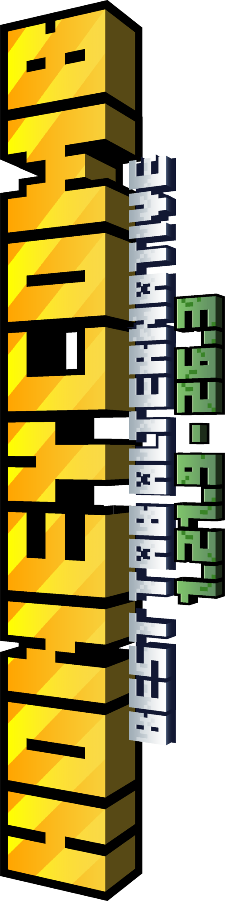
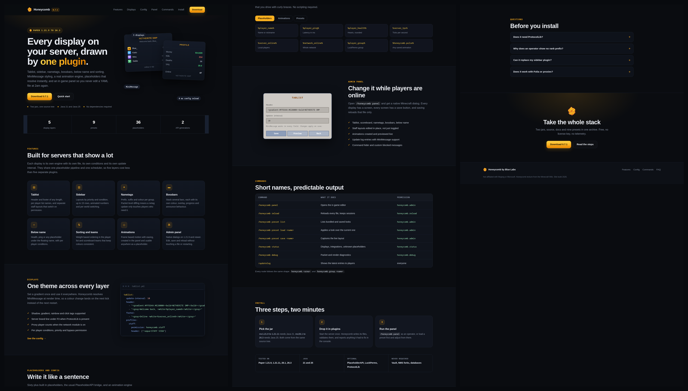

<div align="center">


# Honeycomb

**The TAB alternative for Minecraft 1.21.9 to 26.3.** A tablist plugin, scoreboard plugin,
nametag plugin, bossbar and below name line in one jar, for Paper, Spigot, Bukkit, Folia,
Purpur and Pufferfish.



[](https://github.com/bluegaming08/honeycomb/releases)
[](LICENSE)
[](https://adoptium.net)
[](https://papermc.io)
[](https://papermc.io/software/folia)
[](https://github.com/bluegaming08/honeycomb)
[](../../actions)

[Features](#features) · [Install](#install) · [Commands](#commands) · [Conditions](#conditions) · [Config](#configuration) · [Presets](#presets) · [Contributing](CONTRIBUTING.md)

</div>



Honeycomb owns the parts of the screen players look at all day: the tablist, the
sidebar, the name above each head, bossbars and the line below a nametag. Each one is
a separate engine with its own YAML file, its own update interval and its own
conditions, driven by MiniMessage, placeholders and animations.

It is an original implementation on the Bukkit and Paper APIs. It is not a fork of TAB
or of any other display plugin, and it needs no dependencies to run.

Looking for a TAB alternative, or a tablist plugin that does not need a config wall?
Honeycomb draws the tablist, sidebar, nametags, bossbars and the below name line, and
lets you edit all of it from an in game panel. Per world layouts use one conditions
block on every display. MIT licensed, no paid tier.


## Coming from TAB

One command copies a TAB installation into Honeycomb:

```
/honeycomb migrate          preview what would be copied
/honeycomb migrate apply    back up, write, reload
```

Header, footer, sidebar, nametags, bossbars and the below name display are read
from `plugins/TAB/config.yml` and `groups.yml`. Legacy colour codes become
MiniMessage, and TAB's own placeholders are mapped to their PlaceholderAPI
equivalents. Current files are backed up to `migration-backup/<timestamp>/`
first. Details in [docs/MIGRATION.md](docs/MIGRATION.md).

## TAB alternative: why servers switch

Honeycomb is a common TAB alternative for one reason: the layout lives in an editor,
not in a wall of YAML.

- **No file editing for a text change.** `/honeycomb panel` opens 1.21.9 dialogs that
  edit the tablist header, sidebar rows, nametags, bossbars and animations while
  players are online, writing to `panel.yml` so updates never touch your work.
- **One conditions block, five displays.** Worlds, groups, permissions and placeholder
  comparisons behave the same on tablist, sidebar, bossbars, below name and nametags,
  which is how per world layouts stay readable.
- **Presets that look like real servers.** SMP, PvP, survival, economy, factions,
  DonutSMP and Lifesteal styles ship in the jar, with edited copies backed up before an
  upgrade refreshes them.
- **Folia in the same jar.** Displays are scheduled on the thread that owns each player,
  so Paper, Spigot, Bukkit, Folia, Purpur and Pufferfish all use one file per Java
  version, 1.21.9 to 26.3.
- **No paywall.** MIT licensed, no paid tier, no network calls.

If you are comparing options for Minecraft 1.21.9 and newer, the usual shortlist is
TAB, TAB Reloaded forks, and Honeycomb. TAB wins on years in production, Honeycomb wins
on editing, presets and per world nametags.

TAB is still the safer choice for a large network with a team that knows its config. It
has years of edge cases behind it. Read [docs/CONDITIONS.md](docs/CONDITIONS.md) to see
whether the condition language covers what you need before switching.

## Features

| | |
|---|---|
| **Tablist** | Header and footer of any length, per player list names, separate staff layout behind a permission |
| **Sidebar** | Layouts by priority and condition, up to 15 rows, per world switching, no flicker on updates |
| **Nametags** | Prefix, suffix and colour per group, applied per viewer with packet level diffing |
| **Bossbars** | Several at once, each with colour, overlay, progress and announce behaviour |
| **Below name** | Health, ping or any placeholder under the floating name |
| **Sorting** | Weight based order in the player list, plus teams that keep colours consistent |
| **Animations** | Frame based motion with easing, created in the panel, usable as `{honeycomb.<id>}` |
| **Admin panel** | Native Minecraft dialogs on 1.21.9 and newer, edit and save without a restart |
| **Presets** | Nine looks that mirror common server styles, load, edit, save your own |
| **Update log** | Entries written by staff, read by players with `/updatelog` |
| **Conditions** | World, group, permission and placeholder comparisons pick the layout, like TAB |
| **Per world** | Every display can be limited or replaced per world, nametags and below name included |
| **Staff layouts** | Separate tablist and sidebar for staff, behind a permission |
| **Folia** | Region aware scheduling, so the same jar runs on Folia without a second build |

## Install

Two jars come from one source tree, because the Minecraft generations it supports do
not share a Java runtime:

| Jar | Server | Versions | Java |
|---|---|---|---|
| `Honeycomb-0.9.0-java21.jar` | Paper, Spigot, Bukkit, Folia, Purpur, Pufferfish | 1.21.9 to 1.21.11 | 21 |
| `Honeycomb-0.9.0-java25.jar` | Paper, Spigot, Bukkit, Folia, Purpur, Pufferfish | 26.1 to 26.3 | 25 |

The same jar handles Folia: each display is scheduled on the thread that owns the
player, which is what the region scheduler requires. On Spigot and Bukkit every
display works, and the dialog panel needs Paper.

1. Drop the jar that matches your server into `plugins/`.
2. Start the server once. Honeycomb writes its files and reports anything it adjusted.
3. Run `/honeycomb panel` as an operator, or `/honeycomb preset load smp` first.

PlaceholderAPI, LuckPerms and ProtocolLib are optional. Install ProtocolLib only if
you want the F3 brand line replaced; everything else works without it.

## Commands

| Command | Description | Permission |
|---|---|---|
| `/honeycomb panel` | Opens the in game editor | `honeycomb.admin` |
| `/honeycomb reload` | Reloads every file, keeps sessions | `honeycomb.reload` |
| `/honeycomb preset list` | Lists bundled and saved presets | `honeycomb.admin` |
| `/honeycomb preset load <name>` | Applies a preset over the current layout | `honeycomb.admin` |
| `/honeycomb preset save <name>` | Captures the live layout as a preset | `honeycomb.admin` |
| `/honeycomb status` | Displays, integrations, unknown placeholders | `honeycomb.status` |
| `/honeycomb debug` | Render and packet diagnostics | `honeycomb.debug` |
| `/updatelog`, `/changelog`, `/updates` | Shows the update log to players | everyone |

All nodes follow one shape: `honeycomb.<area>`, plus `honeycomb.group.<name>` for rank
based layouts. Staff layouts need the permission to be granted explicitly, operator
status alone is not enough.

## Conditions

Every layout can carry a `conditions:` block, and the highest priority layout whose
conditions all pass is the one a player sees. Worlds, groups and permissions work out
of the box, and so do placeholder comparisons, which is how a nether tablist or a
wallet board is built:

```yaml
tablist:
  nether:
    priority: 30
    header:
      - "<bold>THE NETHER"
    conditions:
      worlds: [world_nether, nether]

scoreboards:
  high-roller:
    priority: 40
    conditions:
      placeholders:
        - "%vault_eco_balance% >= 100000"
```

Conditions apply to all five displays, including nametags and below name, so a nether
nametag or a staff only board is the same block of YAML. The comparison operators are
`==`, `!=`, `>=`, `<=`, `>` , `<` and `contains`. Numeric
operators compare as numbers, so `100000`, `100,000` and `$100,000` all match. Read
[docs/CONDITIONS.md](docs/CONDITIONS.md) for the full rule set.

## Configuration

```yaml
# plugins/Honeycomb/config.yml
server-name: "NETHERITE SMP"
server-domain: "netheritesmp.net"

tablist:
  update-interval: 20
  header:
    - "<shadow:#000000:1><gradient:#FFD34A:#E28000><bold>%server_name%</bold></gradient></shadow>"
    - "<shadow:#000000:1><gray>Welcome back, <white>%player_name%</white></shadow>"
  footer:
    - "<shadow:#000000:1><gray>netheritesmp.net</gray></shadow>"

scoreboard:
  update-interval: 20
  title: "<shadow:#000000:1><gradient:#FFD34A:#E28000><bold>PROFILE</bold></gradient></shadow>"
  lines:
    - "<shadow:#000000:1><gray>Ping</gray> <dark_gray>-></dark_gray> <green>%player_ping% ms</green></shadow>"
    - "<shadow:#000000:1><gray>World</gray> <dark_gray>-></dark_gray> <green>%player_world%</green></shadow>"
```

Around forty placeholders ship with the plugin, including `%player_name%`,
`%player_ping%`, `%player_health%`, `%player_group%`, `%player_world%`,
`%server_name%`, `%server_online%`, `%server_tps%` and `%network_online%`. Anything
else goes to PlaceholderAPI when it is installed, so money and stat lines can read
`%vault_eco_balance_formatted%` or any placeholder from your own plugins.

## Presets

Bundled looks: `SMP`, `Survival`, `DonutSMP`, `Economy`, `PvP`, `Lifesteal`, `SkyBlock`,
`Prison`, `Factions`. Every preset uses arrows between label and value, `YOURSERVER` as
the heading and `yourserver.net` in the footer, both replaced from `server-name` and
`server-domain` when you load it.

```bash
/honeycomb preset load donutsmp
/honeycomb preset save my-server
```

Presets are plain files in `plugins/Honeycomb/presets`. Edit them freely: an updated
build refreshes the bundled copies and keeps your edited ones in `presets/backup-<version>`.

## Build from source

```bash
git clone https://github.com/bluegaming08/honeycomb.git
cd honeycomb
./gradlew build                      # every module plus tests
./gradlew :honeycomb-legacy:build     # Java 21 artifact
./gradlew :honeycomb-modern:build     # Java 25 artifact
```

Artifacts land in `<module>/build/libs`. The legacy module compiles against the lowest
API of its range, so one jar covers the whole range.

```
honeycomb/
  shared/            code used by both modules, one source of truth
  honeycomb-legacy/  1.21.x entry point and resources
  honeycomb-modern/  26.x entry point and resources
  docs/              API notes, testing notes
  tools/             smoke test helpers
```

## Project status

0.9.0 is the current release. The plugin is in active development: the display engines
and the panel are stable, and the API is published in [docs/API.md](docs/API.md).

## Contributing

Bug reports and pull requests are welcome. Read [CONTRIBUTING.md](CONTRIBUTING.md)
first, and open an issue before a large change so the design can be agreed.

## License

MIT, see [LICENSE](LICENSE). Copyright (c) 2026 Blue Labs.

Honeycomb is not affiliated with Mojang or Microsoft. The honeycomb icon is the item
texture from the Minecraft Wiki.
