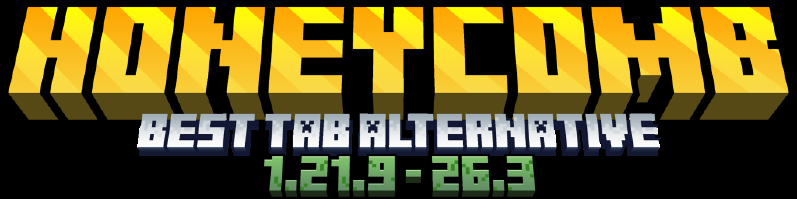

## One plugin. Six displays.

Tablist. Scoreboard. Nametags. Bossbars. Below name. Action bar. Every display uses the same conditions block, so a nether layout is one small block of YAML instead of a second plugin.

- **Edit without a restart.** `/honeycomb panel` changes anything live and saves it to `panel.yml`, so plugin updates never overwrite your work.
- **One screen per display.** Every section lists its layouts with a count, each name opens straight into its fields, and a green button at the bottom creates a new one. Conditions sit at the top of every page.
- **Coming from TAB is one dialog.** Tick tablist, scoreboards, nametags, bossbars and animations, choose merge or replace, done. Backup first.
- **Folia, Paper, Purpur, Spigot, Bukkit, Pufferfish.** One file per Java version. On Folia the scoreboard is drawn with packets, because Folia has no private scoreboards.

## Honeycomb 1.0.0 or TAB?

| | Honeycomb 1.0.0 | TAB |
|---|---|---|
| Tablist, scoreboard, nametags, bossbars | Yes | Yes |
| Below name line | Yes | Yes |
| Action bar | Yes | No |
| Per world layouts on every display | Yes | Yes |
| Placeholder conditions | Yes | Yes |
| Create layouts in game | Dialog panel | Config files |
| Presets in the jar | 9 | No |
| Import a TAB setup | One dialog | n/a |
| Player facing update log | Yes | No |
| Folia | Yes | Yes |

TAB has years of production use behind it. Honeycomb is built around editing in game, the action bar, presets and per world nametags.

## The panel

`/honeycomb panel` opens a dialog with three groups: displays, server and maintenance.

- Each display shows how many layouts it holds, for example `Scoreboard (2)`.
- Inside, one button per layout, then `+ Create new scoreboard` in green.
- A layout page shows who sees it, then the fields: worlds, permissions, placeholder rules, priority, and the text with one row per line.
- `Save changes` applies instantly and confirms in chat. A new layout shows `Create layout` instead.
- `Apply changes` reloads everything, `Done` closes.

## Install

| Jar | Versions | Java |
|---|---|---|
| `Honeycomb-1.0.0-java21.jar` | 1.21.9 to 1.21.11 | 21 |
| `Honeycomb-1.0.0-java25.jar` | 26.1 to 26.3 | 25 |

Drop the matching jar in `plugins/`, start once, run `/honeycomb panel` as an operator. Everything ships switched on: tablist, scoreboard, bossbar, action bar and below name. PlaceholderAPI, LuckPerms and ProtocolLib are optional. The dialog panel needs Paper or Folia.

## Commands

| Command | Does |
|---|---|
| `/honeycomb panel` | Opens the editor |
| `/honeycomb migrate` | Imports a TAB install |
| `/honeycomb preset load <name>` | Applies a preset |
| `/honeycomb reload` | Re-reads every file and applies it |
| `/honeycomb refresh` | Redraws your own displays |
| `/updatelog` | The player facing update log |

Nine presets ship in the jar: SMP, Survival, DonutSMP, Lifesteal, Economy, PvP, SkyBlock, Prison, Factions.

## Placeholders

Built in: `%player_name%`, `%player_world%`, `%player_ping%`, `%player_health%`, `%player_group%`, `%player_prefix%`, `%server_online%`, `%server_max_players%`, `%server_tps%`, `%server_mspt%`, `%time%`, `%date%`, and more. Anything else goes through PlaceholderAPI.

## Links

Source and releases: [github.com/BlueLabsMinecraft/Honeycomb](https://github.com/BlueLabsMinecraft/Honeycomb)  
Docs and downloads: [honey.gamer.gd](https://honey.gamer.gd)

MIT, copyright (c) 2026 Blue Labs. Not affiliated with Mojang or Microsoft.

